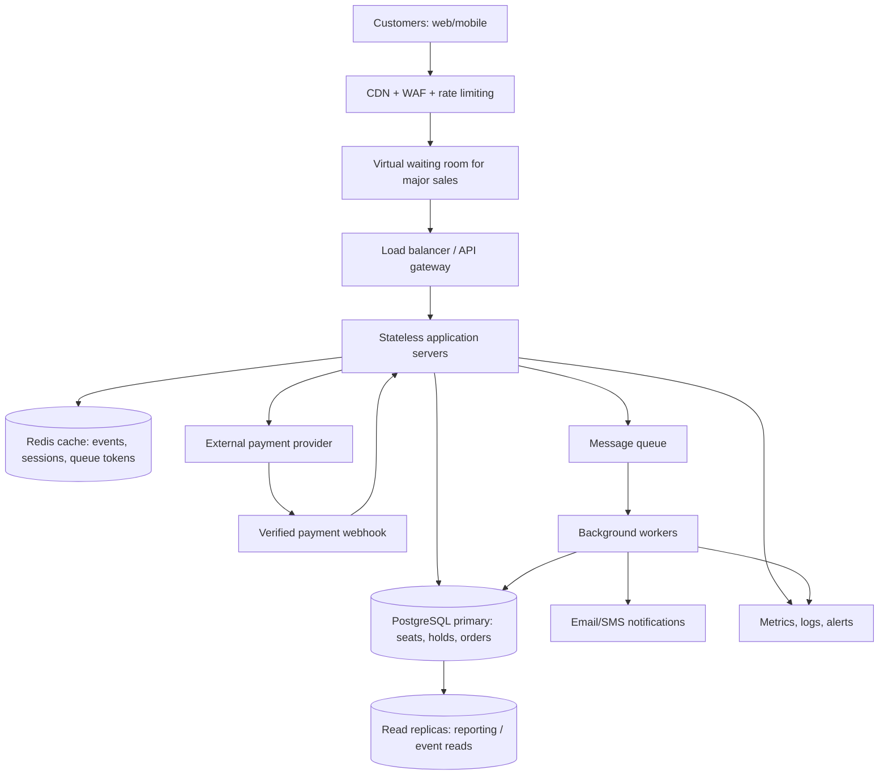

# TicketHub — Event Ticketing System Design

## 1. Clarify requirements

### Functional requirements
- Register, authenticate, and manage customer accounts.
- Browse and search events by name, venue, date, and category.
- View event details, ticket prices, and an up-to-date seating map.
- Select specific seats and place a short-lived hold before checkout.
- Process payments and issue unique digital tickets only after confirmed payment.
- Show order history and ticket details; send purchase confirmations.
- Let authorized organizers manage events, venues, prices, and seat inventory.
- Prevent double-booking and support safe retries, cancellations, and refunds.

### Non-functional requirements
- Target 99.9% monthly availability for browsing and ticketing services, excluding planned maintenance.
- Target p95 cached event-page response time below 500 ms under normal load; target p95 checkout API response below 2 seconds excluding external payment processing.
- Maintain strong consistency for seat ownership and payment/order transitions; eventual consistency is acceptable for search and analytics.
- Encrypt traffic with TLS and sensitive data at rest; use access controls, rate limits, audit logs, and a PCI-compliant payment provider rather than storing card details.
- Scale to sudden concert on-sale spikes without overselling; degrade gracefully using a waiting room.
- Ensure payment webhooks and retries are idempotent; monitor failures and recover safely.

## 2. Estimate scale

### Given workload
| Metric | Calculation | Estimate |
|---|---|---:|
| Registered accounts | Given | 2,000,000 |
| Normal visitors per day | Given | 50,000 |
| Page views per visitor | Given | 10 |
| Daily page views | 50,000 × 10 | 500,000 |
| Average page-view rate | 500,000 / 86,400 | 5.8 requests/sec |
| Tickets sold per day | Given | 5,000 |
| Average ticket sales | 5,000 / 86,400 | 0.058 tickets/sec |
| Popular on-sale visitors | Given | 200,000 in 600 sec |
| Average arriving buyers during sale | 200,000 / 600 | 333 visitors/sec |
| Seats on sale | Given | 20,000 |
| Demand-to-supply ratio | 200,000 / 20,000 | 10:1 |

**Important distinctions:** 333 visitors/sec is an average arrival rate, not a measured HTTP request rate or a peak. Actual traffic will be higher because visitors refresh pages and make multiple API calls. For capacity planning, assume 5 dynamic requests per arriving visitor during the sale, giving approximately **1,667 dynamic requests/sec on average** before caching and queueing; provision and load-test for at least **5,000 requests/sec bursts** as an engineering assumption, not a fact supplied by the prompt. A waiting room caps admission to seat-selection and checkout services. The normal-day 5.8 requests/sec calculation covers page views, not all API or asset requests.

### Illustrative storage estimate
Assumptions (not given facts): 2 KB per user, 1 KB per ticket, 2 KB per order, and 1 KB per seat record, excluding indexes, replicas, logs, and backups.
- Users: 2,000,000 × 2 KB ≈ 4 GB.
- Tickets: 5,000/day × 365 × 1 KB ≈ 1.83 GB/year.
- Orders: assuming one ticket per order, 5,000/day × 365 × 2 KB ≈ 3.65 GB/year.
- Seat inventory: 20,000 × 1 KB ≈ 20 MB for the featured concert.
- Allow additional capacity for indexes, historical events, payment records, audit logs, replication, and backups.

## 3. Design the API

All authenticated endpoints require a valid session/token. POST operations that create orders or payment attempts use an `Idempotency-Key` header.

| Method | Endpoint | Purpose |
|---|---|---|
| POST | `/api/v1/auth/register` | Create account |
| POST | `/api/v1/auth/login` | Authenticate customer |
| GET | `/api/v1/events?search=&date=` | Search and list events |
| GET | `/api/v1/events/{eventId}` | Event details and prices |
| GET | `/api/v1/events/{eventId}/seats` | Seat map and current availability (informational only) |
| POST | `/api/v1/events/{eventId}/holds` | Atomically hold selected seats for 5 minutes |
| DELETE | `/api/v1/holds/{holdId}` | Release a customer's hold |
| POST | `/api/v1/orders` | Create an order tied to a valid customer-owned hold |
| POST | `/api/v1/orders/{orderId}/payment-intents` | Initiate payment with provider |
| POST | `/api/v1/webhooks/payments` | Verify and handle payment-provider events |
| GET | `/api/v1/orders/{orderId}` | Retrieve order and payment status |
| GET | `/api/v1/me/tickets` | List purchased tickets |

**Hold request example:**
```json
POST /api/v1/events/evt_123/holds
{
  "seatIds": ["seat_A12", "seat_A13"]
}
```
Successful response: `201 Created` with `holdId`, `expiresAt`, and `seatIds`. If any seat is unavailable, return `409 Conflict`; no partial hold is created. For queue-controlled events, the endpoint also requires a valid admission token.

## 4. Design the data model

Use PostgreSQL as the authoritative transactional database. Primary keys are UUIDs unless otherwise noted.

| Table | Key fields | Relationships / constraints |
|---|---|---|
| `users` | `id` PK, `email` UNIQUE, `password_hash`, `created_at` | One user has many orders and holds |
| `venues` | `id` PK, `name`, `location` | One venue hosts many events |
| `events` | `id` PK, `venue_id` FK, `title`, `starts_at`, `sale_starts_at` | Many events belong to one venue |
| `seats` | `id` PK, `event_id` FK, `section`, `row_label`, `seat_number`, `price`, `status`, `hold_id`, `hold_expires_at` | UNIQUE(`event_id`, `section`, `row_label`, `seat_number`); seat state is authoritative |
| `holds` | `id` PK, `user_id` FK, `event_id` FK, `expires_at`, `status` | One hold can cover many seats; owned by one user |
| `orders` | `id` PK, `user_id` FK, `hold_id` FK UNIQUE, `status`, `total_amount`, `created_at` | One order references one hold; may have many tickets |
| `payments` | `id` PK, `order_id` FK, `provider_reference` UNIQUE, `status`, `amount` | Provider callbacks processed idempotently |
| `tickets` | `id` PK, `order_id` FK, `seat_id` FK UNIQUE, `qr_token_hash` UNIQUE, `issued_at` | A seat can produce at most one active ticket for this event inventory |

`seats.status` is one of `AVAILABLE`, `HELD`, or `SOLD`. An expired `HELD` seat is reclaimable, even before background cleanup. `holds.status` and `orders.status` are validated state machines, not freely editable strings. All financial amounts are stored in minor currency units.

### Preventing two people from buying the same seat

**The PostgreSQL transaction is the final authority, not the UI or Redis cache.**

1. A buyer selects seats; the UI's availability is only a hint.
2. Start a database transaction and lock all requested `seats` rows in a stable seat-ID order using `SELECT ... FOR UPDATE` to reduce deadlock risk.
3. Check each row while locked: it must be `AVAILABLE`, or `HELD` with `hold_expires_at <= now()` (expired). If any is `SOLD` or has an unexpired hold, roll back the entire transaction and return `409 Conflict`.
4. Insert a `holds` record with a five-minute expiration and update every selected seat to `HELD`, setting `hold_id` and `hold_expires_at`; commit atomically.
5. A second buyer attempting the same seat waits for the row lock. After the first transaction commits, the second buyer sees the active hold and fails. **Only one active hold can own a seat.**
6. Create the order from a valid, unexpired, customer-owned hold. At payment initiation, record the payment attempt and use the provider's idempotency key.
7. On a verified successful payment callback, run another database transaction, lock the order and its seat rows, validate the hold/order ownership and permitted state, mark seats `SOLD`, mark the order `PAID`, and create tickets with a unique constraint on `tickets.seat_id`. Duplicate callbacks do not create duplicate tickets.
8. If payment is late after a hold expires, **do not issue tickets** if the seats have been reclaimed. Instead mark the payment for an automatic refund or manual reconciliation. Payment processing must not silently extend ownership beyond the hold. An optional `PAYMENT_PENDING` reservation state with a bounded grace period could reduce late-payment refunds, but must still retain exclusive ownership transactionally.
9. A background worker releases expired holds conditionally (`status = HELD`, matching `hold_id`, and expired timestamp); it must never free seats that have since been sold or re-held.

**Race example:** Alice and Bob both select A12. Alice acquires A12's row lock and commits a hold. Bob acquires the lock afterward, observes Alice's unexpired hold, and receives `409 Conflict`. Even if a client retries, the seat cannot be sold twice because locking and uniqueness checks happen in the database.

## 5. High-level architecture



### Component responsibilities
- **Web/mobile clients:** Browse events, select seats, and complete checkout; display conflicts and queue position clearly.
- **CDN and WAF:** Cache static assets and public pages, filter abuse, and rate-limit bots.
- **Virtual waiting room:** Smooths the surge by issuing signed, short-lived admission tokens and restricting how many buyers reach inventory services at once. It does not allocate seats.
- **Load balancer / API gateway:** Routes traffic across healthy application instances, checks authentication and admission tokens.
- **Stateless application servers:** Execute business rules, seat-hold transactions, order operations, and verified payment events; scale horizontally.
- **Redis:** Speeds up event listings and non-authoritative seat-map reads, stores queue/session metadata, and can coordinate rate limits. **Never use Redis alone to confirm seat ownership.**
- **PostgreSQL primary:** Source of truth for seats, holds, orders, payments, and tickets; provides ACID transactions, row locks, and uniqueness constraints.
- **Read replicas:** Offload read-heavy queries where slight lag is acceptable; do not validate seat availability or purchases against replicas.
- **Payment provider and webhook:** Process payment securely; webhook signature and event IDs must be verified, with idempotent state transitions.
- **Message queue and workers:** Handle confirmation emails, expired-hold cleanup, refunds/reconciliation, and analytics without slowing the critical checkout path. Use a transactional outbox or equivalent to avoid lost messages between database commits and queue publication.
- **Monitoring:** Track p95 latency, queue size, payment errors, hold conflicts, database lock waits, and oversell incidents (target zero).

### Purchase flow
1. Visitor passes CDN/WAF and, for high-demand events, waits for admission.
2. Application serves event details from cache; seat map is refreshed from authoritative state as needed.
3. Buyer requests a hold; application transaction locks seats and either commits all seats or returns conflict.
4. Buyer starts checkout; payment provider handles payment.
5. Verified callback finalizes seats and tickets in PostgreSQL; notification worker sends confirmation.
6. Expired holds and failed/late payments are safely reconciled.

## 6. Bottlenecks and trade-offs

### What breaks first?
- **Database lock contention:** Thousands of buyers may target the same desirable seats. Mitigate with a waiting room, short transactions, stable lock order, indexes, and bounded hold time. Monitor lock waits and conflict rates.
- **Sudden traffic spikes / bots:** Application instances, rate limits, and payment endpoints may saturate. Mitigate with CDN caching, WAF, admission throttling, autoscaling, and per-user request limits.
- **Payment latency and asynchronous callbacks:** Providers may time out or notify late. Use idempotency, verified webhooks, retries, and refund/reconciliation flows.
- **Stale cached seat maps:** A seat can look available after another buyer holds it. Treat the display as advisory; confirm only at the database transaction and show a clear conflict response.

### Trade-offs

**1. Strong consistency vs. maximum throughput:** Row-level database locks and unique constraints protect seat ownership but create contention and add latency. TicketHub prioritizes never overselling over maximizing concurrent checkout throughput.

**2. Waiting room vs. immediate access:** Queueing prevents overload and improves fairness during popular sales, but users may wait and some may abandon their purchases. This is preferable to crashing checkout for everyone.

**3. Caching vs. real-time accuracy:** Cached listings and seat maps reduce database reads, but may briefly show stale availability. Checkout always verifies inventory against the primary database.

**4. Short holds vs. checkout convenience:** Five-minute holds recycle inventory quickly and discourage hoarding, but customers with slow payments can lose seats. Show a visible countdown and handle late payment with refunds/reconciliation rather than overselling.

### Validation plan
- Concurrently attempt to reserve the same seat from hundreds of simulated clients: exactly one unexpired hold must succeed.
- Retry payment webhooks and order creation: exactly one successful order/ticket outcome per idempotency key and seat.
- Test expired holds, simultaneous cleanup and purchase, delayed payment callbacks, and process crashes.
- Load-test average sale traffic around 1,667 dynamic requests/sec and burst scenarios of 5,000 requests/sec; tune admission rate to measured database capacity.
